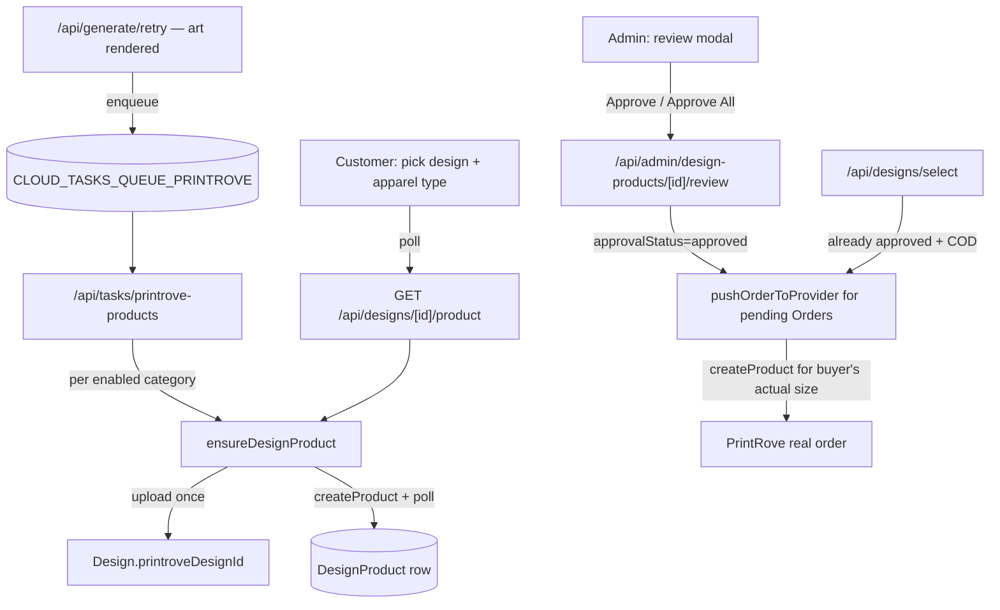

# Requirements

### Overview & Goals
Two originally-separate asks turned out to share a checkout surface, so they're planned together:

1. **PrintRove mockup previews + product-level admin approval.** Today, "admin approval" and the customer-facing mockup are both fake — the admin queue shows a hand-drawn flat SVG tee illustration (`src/lib/mockup.ts`), not a real PrintRove render, and approval happens per-`Order` even though the same design+category+color combo gets re-reviewed for every buyer. This plan makes the admin/customer preview a real PrintRove-rendered mockup, and moves approval to the product level (design × category × color) so approving once covers every future buyer and every size of that combo.
2. **Real customer accounts with saved shipping addresses.** Checkout collects an email today but never actually signs anyone in — `Order.userId` is defined on the schema but is **always null in practice** (verified by grep — no code path sets it). This plan builds actual customer auth (Google **or** email-link, customer's choice) and a saved-address book on `/account`, so checkout can prefill/reuse addresses instead of asking every time.

Track 3 (Cloud Tasks queue infrastructure) is **already implemented** as of this plan being written — see Delivery Steps.

### Scope
**In scope:**
- Google + email-link sign-in for customers (not just admin), sharing the existing `__session` cookie mechanism.
- `Address` model, `/account` page, checkout prefill/snippet/"add another address" UX.
- `DesignProduct` model: one real PrintRove product + mockup per (design, category, color), created eagerly at brew time via a Cloud Task.
- Customer pick-time modal: apparel-type dropdown, polled preview, carousel (brewed art → real mockup), indicative-preview disclaimer.
- Admin review surface: per-design card → same modal in admin mode → Approve/Reject/Approve All per (category, color), cascading to any already-pending Orders.
- Shared `pushOrderToProvider()` fulfillment function, called from admin approve, the approval cascade, and select-time auto-fulfill for already-approved combos.

**Out of scope (explicitly deferred):**
- Second garment color (schema is ready for it; no UI/generation work here — everything is Black-only).
- Auto-fulfill at Razorpay webhook payment time (prepaid orders still land in the human queue as they do today; approving the `DesignProduct` flushes them via the same cascade used for COD). The webhook file wasn't read as part of this plan — touch it in a dedicated follow-up.
- Order history on `/account` (natural next step once `Order.userId` is populated, but not asked for here).
- Address edit/delete UI beyond "add another" (revisit once the basic book is live).
- Revoking a previously-approved `DesignProduct`.

### User Stories
- As a customer, I pick a design, choose an apparel type, see a real preview of my design on that garment (with sizes/pricing for that apparel type), and check out — signing in with Google or an email link, and reusing a saved address if I have one.
- As an admin, I open a design that has pending orders, see every apparel-type/color combo that needs review in one modal (the same one the customer sees), and either Approve All or reject the one that looks wrong — after which every current and future order for the approved combos ships without me touching them again.

---

# Current State (verified this session — do not re-derive, several of these contradict what the code's own comments imply)

| Area | Comment says | Actually is |
|---|---|---|
| Checkout email | "the email a magic-link sign-in is sent to" (`designs/select/route.ts:12-14`) | Used only for transactional email (confirmation/invoice/shipped). No sign-in is ever triggered. |
| `Order.userId` | Has a `User` relation | Defined but **never set** by any code path — confirmed by grep. Every order is anonymous today. |
| `/account` | — | Does not exist. |
| Customer session | — | No customer-facing session check exists. `src/lib/auth.ts`'s primitives (`verifyIdToken`, `createSessionCookie`, `verifySession`) are already role-agnostic; only `isAdminToken`/`getAdminSession`/`requireAdmin` and the `/api/auth/session` route are hard-restricted to the two admin Google accounts. |
| PrintRove mockups | — | `POST /products` returns `mockup: null` immediately; polling `GET /products/{id}` a few seconds later returns real `front_mockup`/`back_mockup` URLs (verified live against the real API this session). Not used anywhere in the app today — the admin/customer preview is `src/lib/mockup.ts`'s generic flat SVG illustration. |
| Approval | Per-Order | `/api/admin/approve` pushes to PrintRove per `Order`; the same design+category+color combo gets fully re-created and re-reviewed for every buyer. |
| Mockup-by-size | — | **Verified empirically**: created two real PrintRove products from the identical uploaded design asset at Men's S and Men's XL — the resulting mockup images are pixel-identical. `settings.printrove.products[category].print` (the placement box) is one fixed value per category, not per size; size only selects which blank variant SKU gets used. This is why approval is scoped to (design, category, color) and not per size — there is nothing a human would review differently between sizes. |
| Cloud Tasks | Referenced in `.env.example`/`GCP_SETUP.md` as a manual `gcloud` step | **Now real infrastructure** (this plan) — see Track D below. |

---

# Technical Design

## Track A — Customer Auth (Google + email-link, customer's choice)

### Key decision: one shared `__session` cookie, role checked per-route
Firebase Hosting's CDN strips every cookie except one named exactly `__session` (see `src/lib/auth.ts:14-21`) — there is no way to run a second, separately-named cookie for customers. This isn't a constraint to work around; it's fine: `verifySession()`/`createSessionCookie()`/`verifyIdToken()` are already generic. The only admin-specific logic is `isAdminToken()` (requires `ADMIN_EMAILS` + `sign_in_provider === "google.com"`), checked at the point of use (`requireAdmin`) — not at cookie-mint time. A signed-in admin is also just a signed-in customer on the same cookie; nothing conflicts.

### Change: generalize `/api/auth/session`
Today (`src/app/api/auth/session/route.ts:21-28`) this route **rejects** any non-admin token with a 403 before minting a cookie at all — meaning only the two admin Google accounts can ever get a session today. Change it to mint the cookie for **any** valid Firebase ID token (Google or email-link), and upsert the `User` row right there:

```ts
const decoded = await verifyIdToken(idToken);
const sessionCookie = await createSessionCookie(idToken);
await prisma.user.upsert({
  where: { id: decoded.uid },
  create: {
    id: decoded.uid,
    email: decoded.email!,
    emailVerified: decoded.email_verified ?? false,
    authProvider: decoded.firebase?.sign_in_provider ?? "email_link",
  },
  update: { email: decoded.email!, emailVerified: decoded.email_verified ?? false },
});
// ...set cookie as today
```
`requireAdmin`/`isAdminToken`/`getAdminSession` are untouched — admin authorization still re-checks on every `/api/admin/*` request independently, so nothing about admin security regresses. This is a deliberate, documented behavior change to a security-relevant route — re-read the current file before touching it (already done once for this plan; do it again if picking this up cold).

### New: `getCustomerSession(req)` / `requireCustomer(req)` in `src/lib/auth.ts`
Mirrors `getAdminSession`/`requireAdmin` exactly, minus the `isAdminToken` check — any valid session cookie qualifies. Backs `/api/account/*` and any checkout step that needs "am I signed in."

### Email-link flow
1. `sendSignInLinkToEmail` is a **client-SDK** call — check `src/lib/email.ts` first (a comment noted "magic-link doesn't have a caller yet," implying a template may already exist there) before deciding: default Firebase-sent email (zero backend work) vs. server-generated link (Admin SDK `generateSignInWithEmailLink`) sent through the existing branded SendGrid/Cloud-Tasks pipeline for visual consistency with the other transactional emails. Recommend the branded route given the pipeline already exists, but the default is a legitimate MVP fallback if a template doesn't already exist.
2. New `src/app/auth/verify/page.tsx` — client page the link points to (`actionCodeSettings.url`). On mount: `isSignInWithEmailLink(auth, location.href)` → `signInWithEmailLink(auth, email, location.href)` (email read from `localStorage`, stored at send-time on the same device; prompt for it if opened elsewhere) → POST the resulting ID token to `/api/auth/session` → redirect back to wherever the flow started (preserve via a `?return=` param).
3. Google sign-in reuses `AdminLogin.tsx`'s `signInWithPopup` pattern in a new customer-facing component — synchronous, no email round-trip. Worth surfacing to the customer as the faster option; email-link has an inherent "check your email" gap that can drop off mid-checkout.

## Track B — Address Book & `/account`

```prisma
model Address {
  id        String   @id @default(cuid())
  userId    String
  user      User     @relation(fields: [userId], references: [id], onDelete: Cascade)
  label     String?
  name      String
  phone     String
  address1  String
  address2  String?
  address3  String?
  city      String?
  state     String?
  pincode   String?
  country   String
  isDefault Boolean  @default(false)
  createdAt DateTime @default(now())
  updatedAt DateTime @updatedAt

  @@index([userId])
}
```
`User` gets `addresses Address[]`. `Order` keeps its own snapshot columns as the source of truth for what actually shipped (an address can be edited/deleted later; an order must not silently change) — add `Order.addressId String?` as a soft, non-authoritative reference back to which saved address was used.

**API:** `GET/POST /api/account/addresses`, `GET /api/account/me` (whoami for the checkout UI to branch on).

**`/account` page** (`src/app/account/page.tsx`, `requireCustomer`-gated): email, sign-in method, saved addresses with a default marked, "add new address" form.

**Checkout integration** (`KeywordStudio.tsx`'s inline form / the new pick-modal): if signed in and ≥1 saved address exists, show a compact one-line snippet (name, address1, city) instead of the full form, with a switcher if there's more than one, and "add another address" revealing the full form. If not signed in, prompt the choice (Google / email link) before the address step — this does add a sign-in gate to checkout that didn't exist before; flagged as a deliberate consequence of "we always create an account," not a hidden cost.

## Track C — PrintRove Mockup Preview + Product-Level Approval

### Schema
```prisma
model Design {
  // ...existing fields...
  printroveDesignId Int?              // PrintRove's uploaded design asset id — set once, reused for every category/color (upload is size/category-agnostic)
  designProducts    DesignProduct[]
}

model DesignProduct {
  id       String @id @default(cuid())
  designId String
  design   Design @relation(fields: [designId], references: [id], onDelete: Cascade)
  category String
  color    String // "Black" only for now

  previewSize        String  // which size variant the mockup was built from — provenance only, proven pixel-identical across sizes, NOT part of identity
  printroveProductId Int?
  printroveVariantId Int?
  mockupFrontUrl     String?
  mockupBackUrl      String?
  status             String  @default("pending") // pending | ready | failed — PrintRove product-creation/mockup lifecycle
  errorMessage       String? @db.Text

  approvalStatus String    @default("unreviewed") // unreviewed | approved | rejected
  reviewedAt     DateTime?
  reviewNote     String?   @db.Text

  createdAt DateTime @default(now())
  updatedAt DateTime @updatedAt

  @@unique([designId, category, color])
  @@index([designId])
}

model Order {
  // ...existing fields...
  designProductId String?
  designProduct   DesignProduct? @relation(fields: [designProductId], references: [id])
}
```
`settings.printrove.products[category]` gets `previewSize`: men `"M"`, women `"M"`, toddler `"2"`, kids `"10"`.

### Brew-time provisioning
`/api/generate/retry`, right after `Design.status` → `"generated"`, calls `enqueuePrintroveProducts(designId)` (new, in `tasks.ts`, mirrors `enqueueEmail`, targets `CLOUD_TASKS_QUEUE_PRINTROVE`, **no synchronous fallback** if the queue isn't configured — the on-demand path below covers that gap). Handler `POST /api/tasks/printrove-products` loops every enabled category through `ensureDesignProduct(designId, category)`.

`src/lib/design-products.ts` → `ensureDesignProduct(designId, category)` — the one function backing both the brew task and the customer-facing endpoint:
- Row + mockup exist → return it.
- Row exists, product created, mockup still null → one `getProduct()` check, update if ready.
- No row → upload art if `Design.printroveDesignId` unset (persist it), `createProduct()` for `(category, previewSize, "Black")`, persist the row, one immediate mockup check.

### Customer flow
`DesignCard`'s inline form becomes a modal. **Drop the category selector from the brew form** — color stays there (it's the only thing that still affects generation); apparel type becomes purely a pick-time choice. Modal: fetch `/api/catalog/categories` (new) → apparel-type dropdown → poll `GET /api/designs/[id]/product?category=men` every ~3s with a spinner until ready → carousel (brewed art, then real mockup) → **directly under the carousel**: *"Preview is indicative — actual print color, placement, and size may vary slightly from what's shown here."* → existing size/qty/payment fields (now also carrying Track B's address snippet/switcher) → submit to `/api/designs/select` with `category` added to the body.

### `/api/designs/select`
`category` added to the Zod body, validated against enabled categories, used (not `design.category`) for the variantMap check and pricing, stored as `productCategory`. Look up/create the matching `DesignProduct`, store its id on `Order.designProductId`. `approvalStatus === "rejected"` → reject the request. `approvalStatus === "approved"` and COD → call `pushOrderToProvider(orderId)` immediately, skipping the human queue.

### Shared fulfillment: `src/lib/fulfillment.ts`
Extract today's inline `/api/admin/approve` body into `pushOrderToProvider(orderId)`, called from exactly three places: manual admin approve, the approval cascade, select-time auto-fulfill. **In every case** it resolves the variant from `order.variantSize` and calls `createProduct()` for that exact size, reusing only `Design.printroveDesignId` (the upload) — never `DesignProduct.printroveProductId`, which was built at `previewSize` and must never be sent to `createOrder`. This is the one place a wrong-variant ship would happen if skipped.

### Admin review surface
Card list: designs with ≥1 `unreviewed` `DesignProduct`. Click → the same modal as the customer's, admin mode: all categories' mockups at once (one per (category, color) — proven representative of every size), Approve/Reject each, **Approve All** at top. `POST /api/admin/design-products/[id]/review` sets `approvalStatus` and, on `"approved"`, calls `pushOrderToProvider` for every currently-pending `Order` matching that combo (multiple buyers may have queued before review); on `"rejected"`, marks those Orders `"rejected"` too. `POST /api/admin/designs/[id]/approve-all` applies the same cascade to every unreviewed row for a design at once. Today's per-Order queue/tabs stay for fulfillment/shipping visibility — this adds the review gate, it doesn't replace order tracking.

## Track D — Cloud Tasks Queue Infrastructure ✓ done (uncommitted locally)
Two separate queues (not one), auto-provisioned by CI, so email and Printrove-product workloads can be tuned independently:
- `.github/workflows/deploy.yml` — new "Ensure Cloud Tasks queues" step: enables the Cloud Tasks API, then creates-or-reconciles `CLOUD_TASKS_QUEUE_EMAIL` (5 attempts, 1h retry window, 10 concurrent/5 per sec) and `CLOUD_TASKS_QUEUE_PRINTROVE` (3 attempts, 3h retry window, 3 concurrent/1 per sec — throttled harder since each task hits a third-party API multiple times).
- `src/lib/tasks.ts` — `CLOUD_TASKS_QUEUE` renamed to `CLOUD_TASKS_QUEUE_EMAIL`.
- `.env.example`, `GCP_SETUP.md` — updated: new secrets documented (`CLOUD_TASKS_QUEUE_EMAIL`, `CLOUD_TASKS_QUEUE_PRINTROVE`), IAM roles added (`cloudtasks.admin` + `serviceusage.serviceUsageAdmin` on the deploy SA, `cloudtasks.enqueuer` on the Cloud Run runtime SA).
- **Verified live against the real `wearthistea` GCP project this session**: Cloud Tasks API enabled, both IAM grants present and correct. Zero queues exist yet only because these workflow changes haven't been pushed/deployed yet — expected, not a problem.
- Note for Track C: the per-task **timeout** for Printrove product creation isn't a queue-creation setting — Cloud Tasks sets that via `dispatchDeadline` at *enqueue* time (max 30 min for HTTP targets), which `enqueuePrintroveProducts()` (Track C, not yet built) needs to set explicitly, longer than the email task's default.

### Architecture (Track C data flow)


### File Structure
- `prisma/schema.prisma` — `Design.printroveDesignId`, `DesignProduct`, `Order.designProductId`/`addressId`, `Address`, `User.addresses`.
- `src/lib/design-products.ts` — new, `ensureDesignProduct`.
- `src/lib/fulfillment.ts` — new, `pushOrderToProvider` (extracted from `/api/admin/approve`).
- `src/lib/tasks.ts` — add `enqueuePrintroveProducts`.
- `src/lib/auth.ts` — add `getCustomerSession`/`requireCustomer`.
- `src/app/api/tasks/printrove-products/route.ts` — new task handler.
- `src/app/api/designs/[id]/product/route.ts` — new, customer polling endpoint.
- `src/app/api/catalog/categories/route.ts` — new, apparel-type list for the dropdown.
- `src/app/api/admin/design-products/[id]/review/route.ts`, `src/app/api/admin/designs/[id]/approve-all/route.ts` — new.
- `src/app/api/account/addresses/route.ts`, `src/app/api/account/me/route.ts` — new.
- `src/app/account/page.tsx`, `src/app/auth/verify/page.tsx` — new pages.
- `src/app/api/auth/session/route.ts` — generalized (admin check removed from cookie-mint; `requireAdmin` still gates admin routes).
- `src/app/api/designs/select/route.ts`, `src/app/api/admin/approve/route.ts`, `src/app/api/admin/batches/route.ts`, `src/components/KeywordStudio.tsx`, `src/app/admin/page.tsx` — modified.

---

# Testing

### Validation Approach
Track C's PrintRove interactions were already partially verified live (real API, not mocked): mockup URL shape, async mockup generation timing, and size-invariance of mockups were all confirmed against the production PrintRove API this session. Track A/B need live verification against the real Firebase project (email-link delivery, session cookie round-trip through Firebase Hosting specifically — not just direct-to-Cloud-Run, since that's what bit the admin cookie-naming issue previously).

### Key Scenarios
- Customer signs in with Google, checks out, address is saved, reappears prefilled on next visit.
- Customer signs in with email-link on the same device (auto-completes) and on a different device (prompted for email).
- An admin session and a customer session coexist correctly in the same browser (same cookie, different route gates).
- Brewing a design successfully creates 4 `DesignProduct` rows (one per enabled category) without the queue configured (falls back to on-demand creation with no crash) and with it configured (task handler populates all 4 ahead of any pick).
- Admin approves one category, rejects another, for the same design — pending Orders for the approved one auto-push; the rejected one's Order is marked rejected and a fresh order attempt for that exact combo is refused at `/api/designs/select`.
- A second buyer orders the same already-approved (design, category, color) in a different size than the first buyer — order auto-fulfills without hitting the admin queue, and the PrintRove order actually places the correct size (not the cached preview size).

### Edge Cases
- Queue not configured (local dev) — Printrove task enqueue no-ops, on-demand `ensureDesignProduct` still works from the pick-time endpoint.
- PrintRove `createProduct` succeeds but mockup generation stalls past a reasonable wait — pick-time modal needs a "still working, try again shortly" state, not an infinite spinner.
- Email-link clicked from an email client's link-scanner/prefetcher (a known Firebase email-link gotcha — some corporate email scanners "click" the link server-side before the real user does, invalidating the one-time code) — verify the verify-page's error state is a clear "request a new link," not a silent failure.
- Rejected `DesignProduct` combo, then colors/re-review are added later — no revoke-and-reopen UI exists in this pass; a rejected row currently stays rejected forever short of a manual DB edit.

---

# Delivery Steps

### ✓ Step 1: Cloud Tasks queue infrastructure (Track D)
Two separate, auto-provisioned queues so email and Printrove-product workloads can be tuned independently.
- Add the "Ensure Cloud Tasks queues" step to `.github/workflows/deploy.yml` (idempotent create-or-update, distinct retry/concurrency config per queue).
- Rename `CLOUD_TASKS_QUEUE` → `CLOUD_TASKS_QUEUE_EMAIL` in `src/lib/tasks.ts`; add `CLOUD_TASKS_QUEUE_PRINTROVE` wiring.
- Document new secrets and required IAM roles in `.env.example` / `GCP_SETUP.md`.
- Verified live: API enabled, both service accounts hold the correct roles on the real `wearthistea` project.

### ✓ Step 2: Schema migration
- Added `Design.printroveDesignId`, `DesignProduct`, `Order.designProductId`, `Order.addressId`, `Address`, `User.addresses`.
- `npx prisma db push` applied live to the Neon database; Prisma Client regenerated; `tsc --noEmit` clean.
- Added `previewSize` to each category in `settings.printrove.products` (men "M", women "M", toddler "2", kids "10").

### ✓ Step 3: Customer auth (Track A)
- Generalized `/api/auth/session` (mints a cookie for any valid token now, upserts `User`); added `getCustomerSession`/`requireCustomer` to `src/lib/auth.ts`. Updated `AdminLogin.tsx` to re-check `/api/auth/me` after sign-in, since the route no longer 403s non-admins itself — preserves the old "not an admin" error message.
- `magicLinkEmail()` template added to `email.ts`; `POST /api/auth/magic-link` generates the link server-side (`generateEmailSignInLink` in `auth.ts`, Admin SDK) and sends it through the existing branded SendGrid/Cloud-Tasks pipeline rather than Firebase's default email. IP-rate-limited (5/15min) via a new generic `checkAndIncrementIpLimit` in `rate-limit.ts`.
- `src/app/auth/verify/page.tsx` completes `signInWithEmailLink`, handles the cross-device case (prompts for email if not found in `localStorage`), mints the session cookie, redirects to `?return=` or `/account`.
- `CustomerSignIn.tsx`: Google popup + email-link request, one component for both checkout and `/account`.
- `GET /api/account/me`: general signed-in-customer whoami (distinct from `/api/auth/me`, which only ever reports admin status).
- **Live infra change** (explicit user approval obtained first): Firebase project's email/password provider had `passwordRequired` effectively `true` — passwordless email-link sign-in was not actually enabled, despite `auth.ts`'s comment claiming it was. Flipped via the Identity Toolkit Admin API (`PATCH .../config?updateMask=signIn.email.passwordRequired`, body `passwordRequired:false`). Verified empirically end-to-end: `generateSignInWithEmailLink` now succeeds against the live project and produces a correctly-shaped link.
- `npm run build` clean (Turbopack) — new routes compile and appear in the route table.

### Step 4: Address book (Track B)
- `GET/POST /api/account/addresses`, `GET /api/account/me`.
- `/account` page.
- Checkout integration: snippet/switcher/add-another in the (soon-to-exist) pick modal.

### Step 5: PrintRove product orchestration (Track C, provisioning half)
- `src/lib/design-products.ts` (`ensureDesignProduct`), `getProduct()` in `printrove.ts`, `FulfillInput`/`FulfillResult` gain `printroveDesignId` passthrough.
- `enqueuePrintroveProducts` + `/api/tasks/printrove-products` handler, wired into `/api/generate/retry`.

### Step 6: Customer pick-time modal + checkout wiring (Track C, UI half)
- `/api/catalog/categories`, `/api/designs/[id]/product`.
- Modal replacing `DesignCard`'s inline form: apparel-type dropdown, polling, carousel with the indicative-preview disclaimer, address snippet from Track B.
- Drop the brew-form category selector.
- `/api/designs/select`: add `category`, approval-aware auto-fulfill branch.

### Step 7: Shared fulfillment + admin review surface (Track C, approval half)
- Extract `pushOrderToProvider` into `src/lib/fulfillment.ts`; rewire `/api/admin/approve` to call it.
- Admin review card list, shared modal in admin mode, `/api/admin/design-products/[id]/review`, `/api/admin/designs/[id]/approve-all`, cascade to pending Orders.
- `/api/admin/batches` joins `DesignProduct` for the mockup image.

**Explicitly not in this plan:** Razorpay webhook auto-fulfill-on-payment (read that file first, separately), second garment color, `/account` order history, address edit/delete, un-rejecting a `DesignProduct`.
