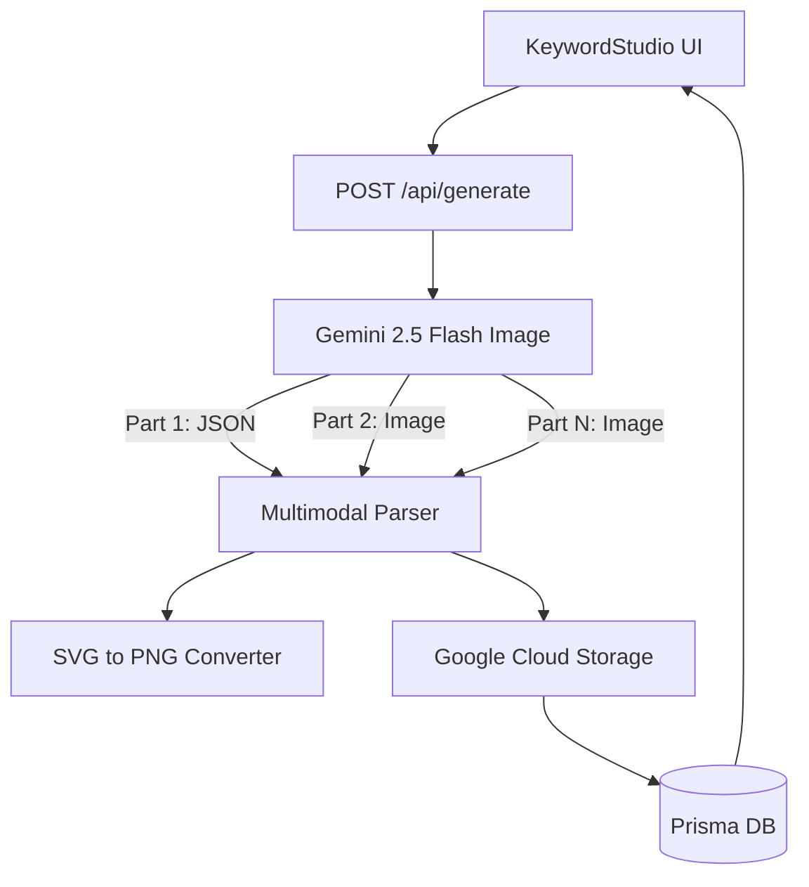

# Requirements

### Overview & Goals
The goal is to modernize the image generation pipeline by leveraging Gemini's latest multimodal capabilities: **Multi-Image Generation**, **Structured Multimodal JSON**, and **SVG Vector Art**. This will significantly reduce latency, lower API costs, and improve design consistency across a batch.

### Scope
- **In Scope:**
    - Consolidating concept and image generation into **Batched Multimodal Calls**.
    - Implementing **SVG Line Art** generation for streetwear graphics.
    - Updating `src/lib/gemini.ts` to parse interleaved JSON and Image parts.
    - Optimized retry logic for batched failures.
- **Out of Scope:**
    - Changing fulfillment providers (Printify/Printrove).
    - Implementing client-side image editing.

### User Stories
- As a designer, I want to see all 5 design concepts and their images generated quickly in one go.
- As a store owner, I want to use SVG-based line art to ensure perfect print quality at a lower cost.
- As a developer, I want a single API call to handle the entire "spill the tea" workflow.

# Technical Design

### Current Implementation
- **Parallel Pipeline:** `generateConcepts` (Text AI) -> N parallel `generateImage` calls (Imagen/Flash Image).
- **Redundant Calls:** Each image generation requires a separate prompt and round-trip, increasing latency (approx. 10-15s total for 5 images).
- **Raster Only:** Limited to PNG/JPG output from Gemini.

### Key Decisions
- **Batched Multimodal Strategy:** Use a single prompt to generate a JSON array of concepts followed by a corresponding sequence of image parts.
- **SVG for Graphics:** Prefer SVG generation for "Line Art" or "Minimalist" styles to improve resolution and reduce token cost.
- **Model Selection:** 
    - Use `gemini-2.5-flash-image` for PNG batches (1290 tokens/image, 1-2s latency).
    - Use `gemini-2.5-flash` for SVG batches (text-only rates, <1s latency).
- **Interleaved Parsing:** Since Gemini cannot efficiently output base64 *inside* JSON strings, we will parse the sequence of parts (Text Part -> Image Part 1 -> Image Part 2...) and map them back to the concept JSON.

### Architecture Diagram

### Proposed Changes
1.  **Unified `generateBatch` Function:**
    - Implement in `src/lib/gemini.ts`.
    - Prompt for JSON schema *and* N images.
    - Set `config: { responseModalities: ["IMAGE"] }`.
2.  **SVG Line Art Pipeline:**
    - Add logic to detect "line art" requests and prompt for SVG code.
    - Use `sharp` to convert SVG to high-res PNG for Print-on-Demand.
3.  **Refactored `/api/generate` Route:**
    - Replace parallel map with a single call to `generateBatch`.
    - Handle partial failures (e.g., if 4/5 images generate).
4.  **UI manual retry:**
    - Allow individual regeneration of a single concept/image if the batch had a failure.

### File Structure
- `src/lib/gemini.ts`: Add `generateBatch` and `generateSVG`.
- `src/lib/svg-utils.ts`: New utility for SVG -> PNG conversion using Sharp.
- `src/app/api/generate/route.ts`: Refactor to use batched logic.

# Testing

### Validation Approach
- **Multimodal Integration:**
    - Verify that `generateBatch` correctly parses interleaved JSON and binary image parts.
    - Ensure that images are mapped to the correct concepts in the JSON list.
- **SVG Rendering:**
    - Verify that generated SVG code is valid and renders correctly to high-res PNG (300 DPI).
    - Test edge cases where SVG generation returns incomplete code.
- **Performance Benchmarking:**
    - Measure latency of Batched Multimodal call vs. previous Parallel Raster calls.
    - Confirm cost reduction (tokens) when using SVG mode.

# Delivery Steps

### ✓ Step 1: Implement Multimodal Batch Parsing in `src/lib/gemini.ts`
Enable the ability to generate multiple concepts and images in a single call.
- Update `generateBatch` to request a JSON schema of concepts followed by N image parts.
- Implement a parser that iterates through `response.candidates[0].content.parts` to extract the JSON and binary image data.
- Add error handling for partial batches (where some images are safety-blocked).

### ✓ Step 2: Implement SVG Vector Art Generation and Rendering
Add support for ultra-high-resolution line art via SVG.
- Create `src/lib/svg-utils.ts` to convert SVG strings to high-res PNGs using `sharp`.
- Add a `generateSVG` function that prompts for clean, streetwear-style SVG code.
- Integrate this into the batch pipeline as an alternative design path.

### ✓ Step 3: Refactor the Generation Route for Batched Execution
Optimize the API to use the new unified pipeline.
- Modify `src/app/api/generate/route.ts` to call `generateBatch` once instead of N parallel calls.
- Update the database logic to store batch results and handle mapping of images to `Design` records.
- Implement diagnostics to track `finishReason` for each part in the batch.

### ✓ Step 4: Update UI for Batch Results and Individual Retries
Enhance the frontend to handle the new batched responses.
- Update `KeywordStudio.tsx` to display results as they arrive from the batch (or all at once).
- Add manual retry capability for specific designs that failed within a batch call.

### ✓ Step 5: Finalize Migration and Deploy
Push changes to remote and remove Railway triggers.
- Remove `railway.json`.
- Update Privacy Policy and code comments to reflect GCP/Firebase migration.
- Push changes to GitHub and verify GHA workflow configuration.