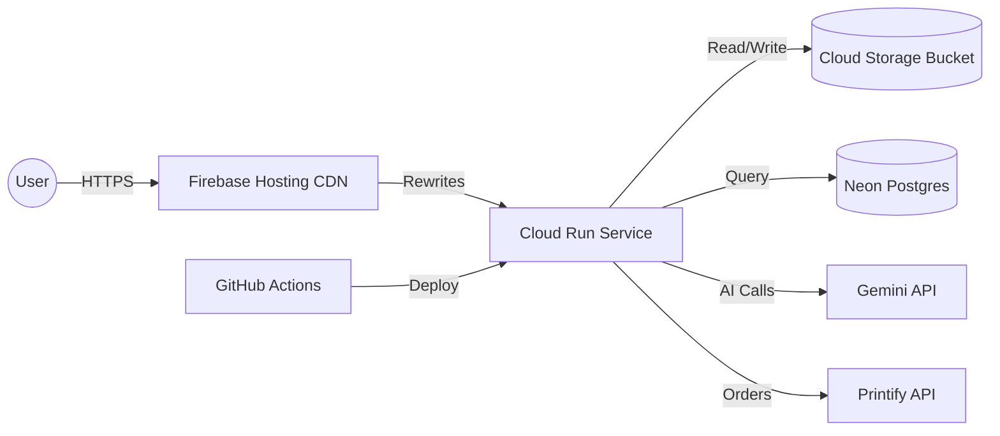

# Requirements

### Overview & Goals
Migrate the `wearthistea` application from Railway to a zero-cost serverless architecture on Google Cloud. This will eliminate the limitations of the expired Railway trial while providing a robust, scalable foundation with a global CDN.

### Scope
- **Compute**: Cloud Run (Serverless API).
- **CDN**: Firebase Hosting (Google's Global CDN with zero base cost).
- **Storage**: Google Cloud Storage (GCS) for persistent design artwork.
- **CI/CD**: GitHub Actions for automated building and deployment.
- **Database**: Retain Neon Postgres (Serverless).

### User Stories
- As a developer, I want to deploy my app for free while I have no users.
- As a developer, I want my generated artwork to persist across container restarts.
- As a developer, I want my code to be automatically deployed when I push to GitHub.

# Technical Design

### Current Implementation
- **Railway**: Long-lived Node process, Railway Volumes for storage.
- **Storage**: Local filesystem operations in `src/lib/storage.ts`.
- **Auth**: Basic Auth logic in `src/proxy.ts` (currently not active as middleware).

### Key Decisions
- **Firebase Hosting as CDN**: Chosen over Cloud CDN to avoid the ~$20/month Load Balancer cost. Firebase Hosting provides a free tier for CDN and SSL.
- **Cloud Run (Standalone)**: Using Next.js `output: 'standalone'` to create minimal Docker images (~100MB) that fit well within the Artifact Registry free tier.
- **GCS Integration**: Replacing filesystem storage with GCS for production to ensure artwork persists when Cloud Run instances scale to zero or restart.

### Architecture Diagram

### Proposed Changes
- **`next.config.ts`**: Enable `output: 'standalone'`.
- **`src/lib/storage.ts`**: Update to use `@google-cloud/storage` when `process.env.GCS_BUCKET` is set.
- **`Dockerfile`**: A new multi-stage build file optimized for Next.js on Cloud Run.
- **`middleware.ts`**: Rename `src/proxy.ts` to `src/middleware.ts` and ensure it correctly handles the Basic Auth gate.
- **`.github/workflows/deploy.yml`**: New CI/CD pipeline.

### Cost Evaluation (Zero Traffic)
 Component | Product | Monthly Cost |
---|---|---|
 Compute | Cloud Run | $0.00 (Free Tier) |
 CDN/Frontend | Firebase Hosting | $0.00 (Free Tier) |
 Image Storage | GCS | $0.00 (Free Tier - 5GB) |
 Image Registry | Artifact Registry | $0.00 (Free Tier - 0.5GB) |
 Database | Neon | $0.00 (Free Tier) |
 **Total** | | **$0.00** |

# Testing

### Validation Approach
- **Storage**: Verify that generated images are correctly uploaded to GCS and served via the `/generated/...` route or directly from GCS.
- **Auth**: Confirm that the Basic Auth gate correctly prompts for credentials on Cloud Run.
- **Deployment**: Trigger a GitHub Action and verify the application is updated on the Firebase Hosting URL.

### Key Scenarios
- **Cold Start**: Verify the app scales up from zero when the URL is visited.
- **Image Generation**: Generate a new design and ensure it persists after the container is manually restarted.
- **Admin Approval**: Ensure the admin flow can still read images from GCS to upload them to Printify.

# Delivery Steps

### ✓ Step 1: Prepare Application for Serverless Deployment
Configure the application for serverless deployment and GCS storage.

- Add `output: 'standalone'` to `next.config.ts`.
- Add `@google-cloud/storage` to `package.json`.
- Modify `src/lib/storage.ts` to support GCS as a production storage backend.
- Rename `src/proxy.ts` to `src/middleware.ts` to ensure Basic Auth works correctly in the new environment.

### ✓ Step 2: Create Optimized Dockerfile
Create an optimized multi-stage Dockerfile for Next.js.

- Use `node:20-alpine` as the base image.
- Implement multi-stage build (install, build, runner).
- Ensure sharp and other native dependencies are handled correctly.
- Optimize image size for Artifact Registry free tier.

### ✓ Step 3: Implement GitHub Actions CI/CD Pipeline
Set up the automated deployment pipeline to Google Cloud.

- Create `.github/workflows/deploy.yml`.
- Add steps for:
    - Authenticating with GCP (via Workload Identity Federation or Service Account).
    - Building and pushing the Docker image to Artifact Registry.
    - Deploying to Cloud Run with appropriate environment variables and secrets.
    - Updating Firebase Hosting to point to the new Cloud Run revision.

### ✓ Step 4: Finalize Infrastructure Configuration
Finalize the Firebase Hosting and GCS configuration.

- Create `firebase.json` to handle rewrites to Cloud Run.
- Provide a setup script or guide for creating the GCS bucket and setting permissions.
- Document the new environment variables needed in Cloud Run (GCS_BUCKET, etc.).

### ✓ Step 5: Configure PrintRove Fulfillment in CI/CD
Ensure PrintRove API credentials and settings are correctly handled in the serverless environment.

- Update `.github/workflows/deploy.yml` to include PrintRove environment variables.
- Update `GCP_SETUP.md` to document the required PrintRove secrets.
- Verify that `src/lib/printrove.ts` and `src/config/settings.ts` correctly handle these variables in production.